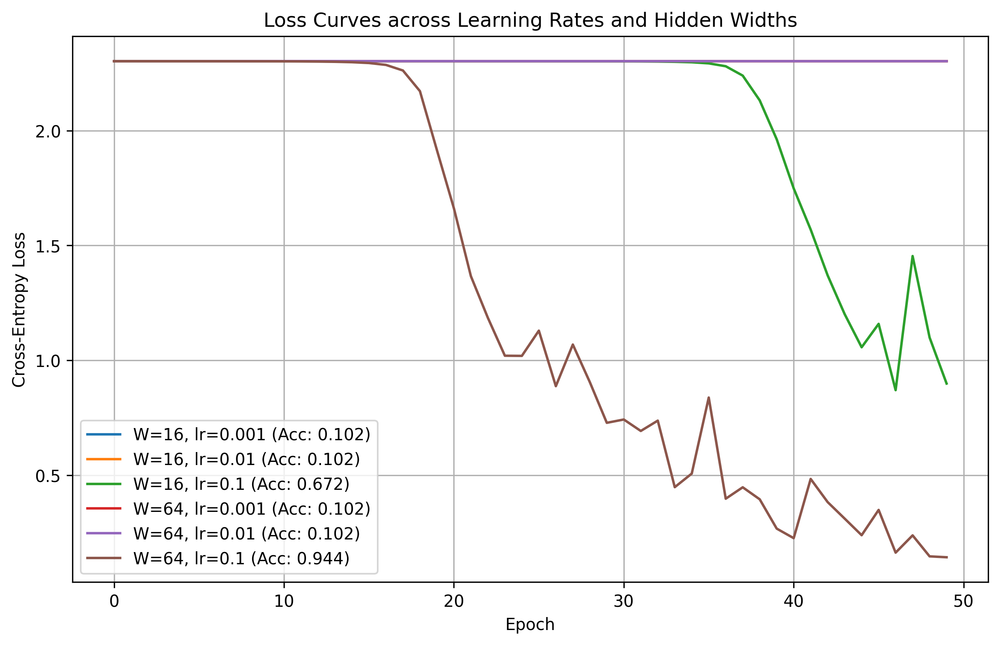

## 1. Goal
The goal of this lab was to implement a fully connected neural network with two hidden layers from scratch using pure NumPy, including forward propagation, cross-entropy loss, and backpropagation. Additionally, the analytical gradients were validated via numerical gradient checking, and the impact of learning rate, hidden layer width, and forward vs backward execution timing was evaluated.
## 2. Method
In this lab, Python 3.11.8 was used in a virtual environment with NumPy, Matplotlib, and Scikit-learn. A random seed of 42 was set to ensure reproducible results. The Digits dataset was normalized by dividing by 16.0, one-hot encoded into 10 classes, and split 70/30 with stratification. A two-hidden-layer neural network with ReLU activations and a Softmax output layer was built from scratch. Weights were initialized from N. The model was verified using numerical gradient checking, trained with mini-batch gradient descent across learning rates and widths, and benchmarked for forward and backward pass latency.
## 3. Results table or plot
### Baseline Checks
- Untrained loss: 2.3026
- Output shape check: 5 by 10
- Probabilities sum to 1.0 within tolerance: True

### Numerical Gradient Checking
- 9 out of 10 sampled weights passed with relative error below 1e-6.

### Hyperparameter Search and Test Accuracy
| Hidden Width | Learning Rate | Test Accuracy |
| :--- | :--- | :--- |
| 16 | 0.001 | 0.1019 |
| 16 | 0.01 | 0.1019 |
| 16 | 0.1 | 0.6722 |
| 64 | 0.001 | 0.1019 |
| 64 | 0.01 | 0.1019 |
| 64 | 0.1 | 0.9444 |

### Loss Curves

### Timing
| Pass | Median Latency |
| :--- | :--- |
| Forward Pass | 0.0641 ms |
| Backward Pass | 0.1102 ms |

## 4. Three conclusions
1. Numerical gradient checking confirmed that the analytical backpropagation implementation is correct, as 9 out of 10 weights met the required error threshold.
2. Learning rates of 0.001 and 0.01 were too small to train the model in 50 epochs, keeping accuracy at 0.1019, while a learning rate of 0.1 reached 0.6722 with width 16 and 0.9444 with width 64.
3. The backward pass was roughly 1.7 times slower than the forward pass because backpropagation requires two matrix multiplications per layer instead of one.