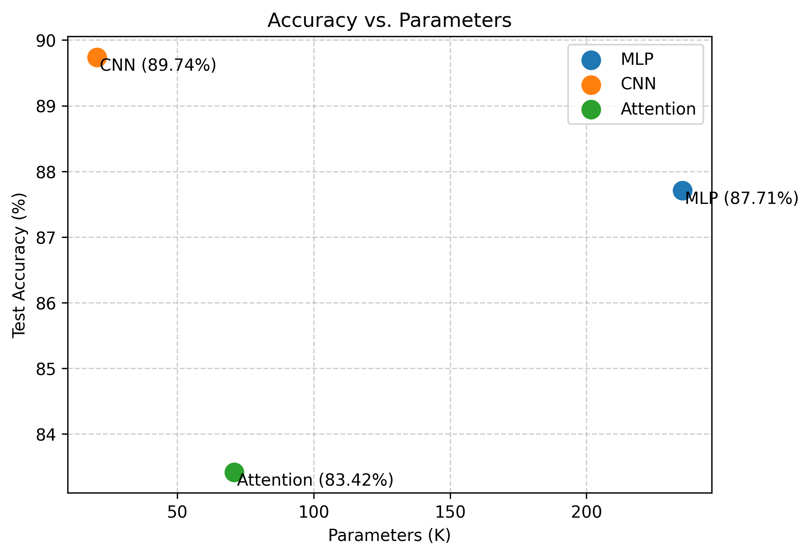
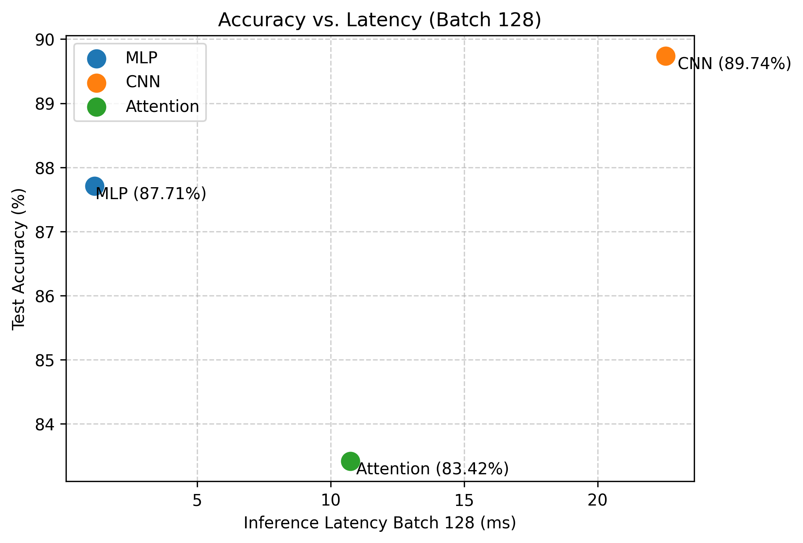
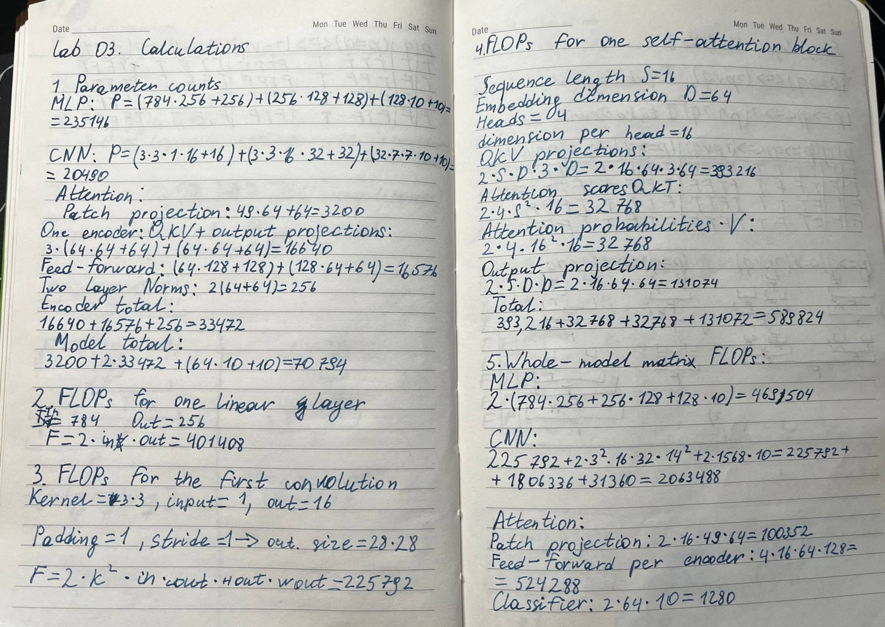
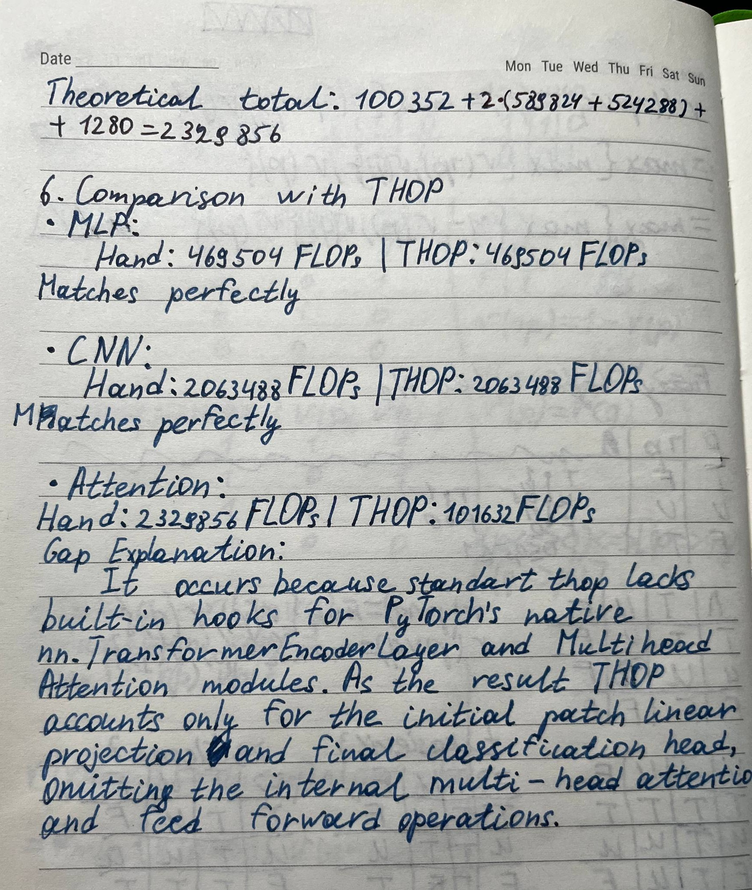

# Lab 3: Architectures and their costs

## 1. Goal
The goal of this lab was to implement and compare three neural network architectures on Fashion-MNIST. The models were evaluated on parameter count, theoretical and measured FLOPs, single-sample and batch inference latency, and final classification accuracy after 5 training epochs.

## 2. Method
Python 3.11.8 was used in a virtual environment with PyTorch, Torchvision, Torchinfo, and THOP. The random seed was set to 42 for reproducibility. The Fashion-MNIST dataset was normalized using mean 0.2860 and standard deviation 0.3530. The official 60k training set was split into 55k train and 5k validation samples, and testing was done on the official 10k test set. Three models were built: a 3-layer MLP, a 2-layer CNN with max pooling and a linear classifier, and a Patch Attention model that splits 28x28 images into 16 patches of 7x7 followed by two Transformer encoder layers and mean pooling. Representative layer FLOPs were calculated by hand using textbook formulas and compared with THOP profiling. All models were trained for 5 epochs using Adam with learning rate 1e-3 and batch size 128 on CPU, and inference latency was measured as the median of 100 runs for batch 1 and 20 runs for batch 128.

## 3. Results table or plot
### Model Cost and Performance Comparison
| Model | Parameters | THOP FLOPs | Latency Batch 1 | Latency Batch 128 | Test Accuracy |
| :--- | :--- | :--- | :--- | :--- | :--- |
| MLP | 235,146 | 469,504 | 0.3169 ms | 1.1590 ms | 0.8771 |
| CNN | 20,490 | 2,063,488 | 0.9064 ms | 22.5390 ms | 0.8974 |
| Attention | 70,794 | 101,632 | 2.4497 ms | 10.7458 ms | 0.8342 |

### Hand-calculated vs. Profiler FLOPs
| Representative Layer | Hand-calculated FLOPs | Layer Formula |
| :--- | :--- | :--- |
| MLP: Linear (784 to 256) | 401,408 | 2 * 784 * 256 |
| CNN: Conv2d (16 to 32, 14x14) | 1,806,336 | 2 * 3 * 3 * 16 * 32 * 14 * 14 |
| Attention: QKV Projection (seq 16, d 64) | 393,216 | 2 * 16 * 64 * 3 * 64 |

### Trade-off Plots

### Hand Calculations

## 4. Three conclusions
1. The noticeable gap between hand-calculated and thop.profile FLOPs arises because standard profilers like THOP lack built-in hooks for PyTorch native Transformer modules, registering only linear projection heads while manual formulas account for the full self-attention matrix operations.
2. Balancing performance and resource use, the CNN proves to be the superior choice by delivering peak accuracy (89.74%) using a remarkably small number of parameters (20,490). Even though its latency exceeds that of the MLP due to high compute density and sliding-window memory access, the MLP's heavy parameter burden (235,146) heavily undercuts its cost-effectiveness.
3. Although the Patch Attention model achieves the lowest profiled FLOPs due to tokenizing the image into only 16 patches, it suffers from the lowest test accuracy (83.42%) and high single-sample latency (2.4497 ms). As explained by access pattern analysis, attention mechanisms suffer from non-contiguous memory access and lack local 2D spatial inductive bias, making them inefficient on small-scale vision tasks.